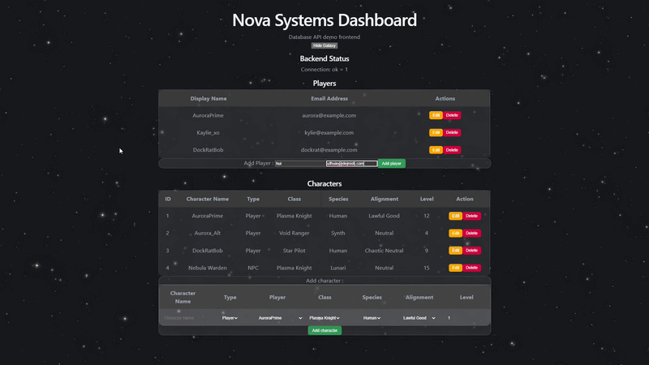

# tabletop-game-management-system

Relational database + CRUD demo REST API wrapper


The application uses:

- **FastAPI** for the backend API
- **Uvicorn** as the ASGI server
- **SQLite** for the database
- **React + Vite** for the frontend
- **Docker Compose** to run the frontend and backend together

> Project intentionally not using an ORM like SQL Alechemy nor Flask, due to extensive prior use of Flask-based frameworks. See project below for SQL database implementaion via ORM: 
<https://github.com/nievyx/FlaskInventoryApp>

> seed.sql setup with a space themed tabletop game ~~alongside a DRM platform~~

## Docker Setup 🐋
From the project root, run:

```commandline
docker compose up --build
```

## Demo 


## Quick start

```bash
python backend/database/reset_db.py
uvicorn backend.app.main:app --reload
```

## Reset Database
```
python backend/database/reset_db.py
```
# Run Both Frontend and Backend
Terminal 1:
```
uvicorn backend.app.main:app --reload
```
or
```
python -m backend.app
```
Terminal 2:
```
cd frontend
npm run dev
```


## Root File Structure
```
├── docs/
│   ├── erd.png
│   ├── data-dictionary.docx
│   └── notes.md
├── demo/
│   └── demo.py
│   └── test_db.py
├── README.md
├── docker-compose.yml 🐋
```

## Backend File Structure
```
root/

├── backend/
│   ├── app/
│   │   ├── main.py
│   │   ├── routes/
│   │   │   ├── players.py
│   │   │   ├── profiles.py
│   │   │   ├── assets.py
│   │   │   └── quests.py
│   │   ├── models.py
│   │   └── schemas.py
│   ├── database/
│   │   ├── schema.sql
│   │   ├── seed.sql
│   │   ├── reset_db.py
│   │   └── db.py
│   └── requirements.txt
```
## Frontend File Structure
```
├── frontend/
│   ├── src/
│   │   ├── api/
│   │   │   └── client.js
│   │   ├── pages/
│   │   │   ├── HomePage.jsx
│   │   │   ├── ProfilesPage.jsx
│   │   │   ├── Assets.jsx
│   │   │   └── Quests.jsx
│   │   ├── components/
│   │   │   └── Profiles.jsx
│   │   ├── App.jsx
│   │   └── main.jsx
│   ├── package.json
│   └── vite.config.js

```
<details>
<summary>Toggle optional Java structure<strong> 
</strong></summary>

### Optional Java Demo
```java
└── java_demo/
    ├── README.md
    ├── pom.xml
    └── src/
        └── main/
            └── java/
                └── Demo.java
```
</details>

